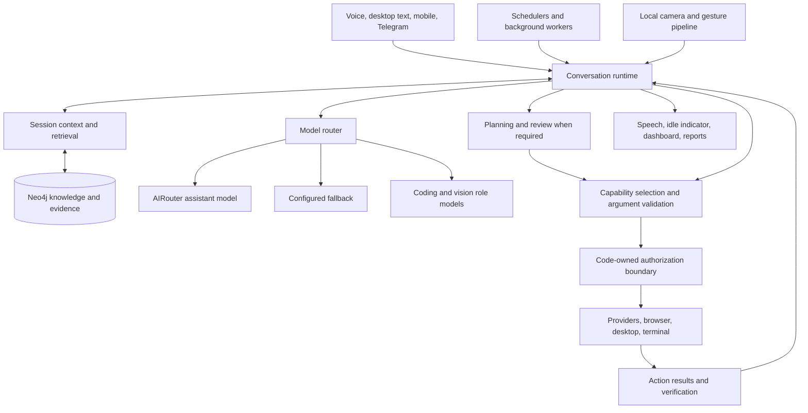

# VANTA

### A voice-first personal assistant with persistent graph memory and desktop tools.

VANTA is a Windows-focused Python assistant built to connect conversation with
useful work: remembering context, researching questions, managing schedules,
working with files, automating the browser, and assisting with coding projects.
The project retains its original **WINTER** repository name and some legacy
configuration names.

Rather than treating every request as an isolated question, VANTA combines the
current conversation, retrieved knowledge, available tools, and action results
to decide what to do next.

> **Project status:** actively developed personal software, not a production
> service or a guarantee of autonomous correctness. Capabilities depend on local
> setup, permissions, connected accounts, model availability, and the application
> being controlled. Review consequential actions and keep independent backups.

## What VANTA brings together

- **Natural interaction:** wake-word activation, push-to-talk, speech recognition,
  spoken responses, conversational follow-ups, interruption, and cancellation.
- **Persistent knowledge:** Neo4j-backed facts, relationships, conversation
  evidence, provenance, validity periods, and correction history.
- **Desktop and browser workflows:** accessibility controls, screenshots, OCR,
  Firefox automation, form interaction, file operations, and terminal execution.
- **Planning and follow-through:** alarms, tasks, calendar operations, routines,
  condition watches, follow-ups, and budgeted background reviews.
- **Research and learning:** web and academic lookup, study assistance, and rich
  reports with tables, mathematics, diagrams, images, and supported 3D scenes.
- **Build assistance:** project-aware coding, command execution, Blender helpers,
  dataset tools, and bounded ML build workflows.
- **Local perception:** optional object detection, face identity, and hand
  gestures, with a separate vision-model route for richer visual understanding.
- **Connected services:** adapters for Google services, GitHub, Telegram, media,
  maps, public information, and an authenticated mobile web client.

These are implemented integration surfaces, not a promise that every website,
file format, or real-world task can be handled without supervision.

## Architecture



Simple turns can take a direct execution path. More involved work can use
planning and review. Tool discovery narrows the available capabilities instead
of requiring the model to reason over every action definition on every turn.

The model proposes actions; application code validates and authorizes them.
Retrieved memories cannot grant permissions that the code does not allow.
Action receipts provide evidence for completion claims; sending an input is
not necessarily proof that the intended application state changed.

### Memory design

The core graph retains the existing structure:

```text
(:Entity)-[:FACT]->(:Entity)
(:Memory)
(:DialogueSession)-[:CONTAINS]->(:DialogueTurn)
```

Retrieval combines recent dialogue with relevant graph facts and historical
memory. Facts can carry provenance, confidence, sensitivity, review status,
validity, and supersession metadata. Explicit facts, self-reported patterns,
reviewed inferences, and unconfirmed hypotheses are treated differently.

Current conversation context takes precedence over older assumptions. Raw
evidence and historical records are distinct from facts selected for ordinary
context. Retrieval remains fallible: an absent result is not proof that a fact
was never stored.

See [Conversation Architecture](CONVERSATION_ARCHITECTURE.md),
[Neo4j Memory](NEO4J_MEMORY.md), and [Graph Lifecycle](GRAPH_LIFECYCLE.md).

## Interaction modes

- **Assistant:** everyday conversation, coordination, and task execution.
- **Study:** screen-aware explanations, learning support, and focus assistance.
- **Research:** source gathering, verification, synthesis, and knowledge work.
- **Build:** project files, coding, build commands, datasets, and development tools.
- **Health:** cautious support grounded in available information and imported data;
  not medical diagnosis or emergency care.
- **Sleep:** quieter interaction and deferred routine information, subject to
  configured alarm and interruption rules.

Standby and standby monitoring are additional rest controls. They are distinct
from putting Windows itself to sleep. When the computer is suspended, VANTA
cannot listen, monitor, or execute scheduled work until the system resumes.

## Getting started

### Prerequisites

- Windows and Python 3.11; Windows-specific controls are not portable by default.
- A microphone and audio output. A camera is required for the configured face
  verification flow and optional camera features.
- Neo4j and a compatible Java runtime.
- An AIRouter account/key for the example assistant configuration.
- Firefox for the default installed-browser automation route.
- Optional Node.js/npm for the mobile frontend; Blender for Blender workflows.

**This repository is a source snapshot, not a complete installer.** Virtual
environments, model weights, the Neo4j runtime, enrolled faces, and credentials
are intentionally absent. The feature-specific requirements files do not yet
constitute a complete, locked installation manifest for the desktop application.

### 1. Clone and create your environment

```powershell
git clone https://github.com/himanshu2005-tech/winter.git
cd winter
py -3.11 -m venv .venv
.\.venv\Scripts\Activate.ps1
Copy-Item .env.example .env
```

Install dependencies appropriate to the features you use. Existing dependency
groups are:

```powershell
python -m pip install -r requirements-memory.txt
python -m pip install -r requirements-browser.txt
python -m pip install -r requirements-vision.txt
python -m pip install -r requirements-build.txt
```

Additional desktop/audio dependencies are imported by the application, including
CustomTkinter, Pillow, sounddevice, pygame, faster-whisper, PyTorch, pynput,
PyAutoGUI, python-dotenv, requests, and the OpenAI-compatible client library.
Choose PyTorch/ONNX packages for your hardware; do not assume CUDA compatibility.

### 2. Configure private settings

Edit your local `.env`; never commit it. The example assistant route is:

```dotenv
WINTER_PROVIDER=airouter
WINTER_MODEL=anthropic/claude-haiku-5.5
AIROUTER_API_KEY=your_private_key
AIROUTER_BASE_URL=https://api.airouter.in/v1
```

Coding and vision have separate role settings in [.env.example](.env.example).
ChatGPT fallback requires a separately authenticated account and a model exposed
by that account. It is not enabled merely by entering a model name.

For graph access, configure `NEO4J_URI`, `NEO4J_USER`, `NEO4J_DATABASE`, and
`NEO4J_PASSWORD`, or use the supported Windows Credential Manager entries.
Additional integration keys and OAuth grants are needed only for the providers
you enable. `AUTH_PASSWORD` is the local authentication fallback; use a strong,
unique value.

### 3. Prepare the local runtime

The current launcher expects a Neo4j Community distribution under
`.runtime/neo4j/neo4j-community-*`. Its Java path can be overridden with
`WINTER_JAVA_HOME`. Review [scripts/start_neo4j.py](scripts/start_neo4j.py) before
adapting the launcher for an externally managed database.

Prepare the face-identity configuration and enrollment used by your installation.
The normal launcher performs identity verification **before** starting the main
assistant and Neo4j. A fresh clone does not contain an enrolled identity.
Optional local perception models also need to be downloaded separately.
Check their licenses, especially pretrained face-recognition weights.

### 4. Launch

From the project directory:

```powershell
.\start.bat
```

The default talk key is **F9**. Wake-word listening and gestures depend on local
device/model setup. For desktop launch options, the repository also includes
`launch_vanta.vbs`, `start_quiet.vbs`, and `tray_launcher.pyw`.

## Mobile access

`vanta-mobile/` is an Expo/React Native frontend with an installable web build.
It connects to the same assistant through `mobile_gateway.py`; it does not run
a separate brain or duplicate the action policy.

The intended private deployment uses **Tailscale Serve** for the gateway and
optional **Firebase Hosting** for the static frontend. Do not expose the gateway
port directly to the public internet. Configure your own hosting project,
allowed origins, pairing password, and Tailscale address.

See [Mobile Setup](MOBILE_APP.md) and the
[frontend README](vanta-mobile/README.md). Browser microphone/background limits
still apply; the web app does not provide native HealthKit access.

## Repository guide

- `agent.py`, `runtime/`: conversation orchestration and execution state.
- `actions.py`, `capabilities.py`, `action_registry.py`: action dispatch and discovery.
- `memory/`: graph storage, retrieval, consolidation, and import infrastructure.
- `providers/`: service adapters and provider authentication.
- `ui.py`, `control_center.py`, `report_*.py`: desktop surfaces and report rendering.
- `stt.py`, `voice.py`, `wakeword.py`: listening, recognition, and speech output.
- `camera_*.py`, `face_identity.py`, `gesture_wake.py`: local perception and identity.
- `scripts/`, `tests/`: operational checks and regression tests.
- `vanta-mobile/`: mobile/web client source.

The application creates private working state under `vault/`. That directory
is deliberately not part of this repository.

## Privacy and safe operation

- Keep tokens, passwords, OAuth files, private keys, and personal exports local.
- Cloud model requests can include permitted task context. Local detection does
  **not** mean that the entire assistant runs offline.
- Review privacy settings and provider disclosure rules before connecting mail,
  health information, contacts, or sensitive screen content.
- Terminal execution and GUI automation operate with your Windows permissions.
  Run in an appropriately restricted account and supervise destructive actions.
- Face matching is not a guarantee of liveness or high-assurance authentication.
- Back up your Neo4j data and vault separately. Source control is not a personal
  memory/database backup.

The initial GitHub publication intentionally excluded old local Git history
because it contained private files. **Do not merge or push that old history**
into this repository. See [Source Publication](SOURCE_PUBLICATION.md).

## Testing

Use a separate development environment. Some legacy tests require live services
or devices; do not run them against your personal graph without isolation.

One bounded regression selection is:

```powershell
python -m pip install pytest
python -m pytest -q tests/test_curiosity.py tests/test_deduction.py tests/test_entity_linking.py tests/test_action_visibility.py::EmailDigestTests -p scripts.action_test_audit --isolated-action-audit
```

That selection passed **222 tests and 26 subtests** during source publication.
All **452 Python files** in the published snapshot passed syntax parsing.
These are scoped checks, not proof that all integrations or hardware scenarios
have passed end-to-end testing.

The repository includes a Gitleaks configuration for source credential scanning.
The publication scan found no leaks after replacing personal test-fixture contact
details. One narrowly scoped Mermaid parser false positive is documented in
[.gitleaks.toml](.gitleaks.toml).

## Further documentation

- [Runtime Architecture](RUNTIME_ARCHITECTURE.md)
- [Action Execution](ACTION_EXECUTION.md)
- [Browser Reliability](BROWSER_RELIABILITY.md)
- [Windows Control](WINDOWS_CONTROL.md)
- [Retrieval Quality](RETRIEVAL_QUALITY.md)
- [Vision Architecture](VISION_ARCHITECTURE.md)
- [Rich Reports and Media](REPORT_MEDIA.md)
- [Proactive Behavior](PROACTIVE_BEHAVIOR.md)
- [Approval Handoff](APPROVAL_HANDOFF.md)

VANTA is built around a practical goal: preserve context, select the right
resource, do useful work, and report what actually happened.
